# Diagrama UML y Arquitectura de TDA — MercaBazurto Digital

> **Asignatura:** Estructuras de Datos (Java 17) — Proyecto Integrador 9  
> **Institución:** Universidad Mayor de Cartagena / Institución Universitaria Colegio Mayor de Bolívar  
> **Arquitecto de TDA y Líder:** Miguel Andrés Baza Contreras

---

## 1. Principio Arquitectónico del Núcleo

El núcleo del sistema (`src/modelo`, `src/estructuras`, `src/algoritmos`) está programado **100 % en Java 17 puro** utilizando exclusivamente arreglos nativos (`[]`), nodos genéricos (`Nodo<T>`, `NodoDoble<T>`) y referencias propias (`sig`, `ant`). **No se emplea ninguna colección de Java** (`ArrayList`, `LinkedList`, `Queue`, `Stack`, `HashMap`, `HashSet`, `Collections.sort` ni `Arrays.sort`) ni árboles.

La interfaz visual minimalista en `web/` funciona **100 % offline** gracias al servidor HTTP integrado del JDK 17 (`com.sun.net.httpserver.HttpServer`) dentro de `src/app/ServidorApp.java`.

---

## 2. Diagrama de Clases UML (Mermaid)

```mermaid
classDiagram
    direction TB

    class Nodo~T~ {
        +T dato
        +Nodo~T~ sig
        +Nodo(T dato)
    }

    class NodoDoble~T~ {
        +T dato
        +NodoDoble~T~ ant
        +NodoDoble~T~ sig
        +NodoDoble(T dato)
    }

    class ListaSimpleLotes {
        -Nodo~Lote~ cabeza
        -int tamanio
        +insertarOrdenado(Lote nuevoLote) void
        +venderDesdePrimero(int kgSolicitados) int
        +venderDesdePrimeroConDetalle(int kgSolicitados) ResultadoVentaLotes
        +retirarVencidos(String fechaHoy) int
        +calcularValorRecursivo() long
        +calcularValorRecursivo(Nodo~Lote~ actual) long
        +calcularKgTotales() int
        +aArreglo() Lote[]
    }

    class ListaSimplePedidos {
        -Nodo~Pedido~ primero
        -Nodo~Pedido~ ultimo
        -int tamanio
        +registrarPedido(Pedido pedido) void
        +despacharSiguiente() Pedido
        +cancelarPorCodigo(String codigo) Pedido
        +verPrimero() Pedido
        +aArreglo(int limite) Pedido[]
    }

    class ListaSimpleVentas {
        -Nodo~Venta~ cabeza
        -int tamanio
        +registrarVenta(Venta venta) void
        +calcularTotalVendido() long
        +calcularGananciaTotal() long
        +aArreglo() Venta[]
    }

    class ListaCircular~T~ {
        -Nodo~T~ ultimo
        -int tamanio
        +insertar(T dato) void
        +siguienteTurno() T
        +verProximoTurno() T
        +eliminar(T dato) boolean
        +llenarArreglo(T[] destino) void
    }

    class ListaDoble~T~ {
        -NodoDoble~T~ primero
        -NodoDoble~T~ ultimo
        -int tamanio
        +insertarAlInicio(T dato) void
        +insertarAlFinal(T dato) void
        +eliminarPrimero() T
        +eliminarUltimo() T
        +eliminarDato(T dato) boolean
        +recorrerAdelante(T[] destino) int
        +recorrerAtras(T[] destino) int
    }

    class Producto {
        -String codigo
        -String nombre
        -String categoria
        -long precioCompraKg
        -long precioVentaKg
        -ListaSimpleLotes lotes
        +calcularGananciaPorKg() long
        +calcularPorcentajeMargen() double
        +actualizarDatos(String, String, long, long) void
        +calcularValorInventarioRecursivo() long
        +calcularKgDisponibles() int
    }

    class Lote {
        -String codigoLote
        -String codigoProducto
        -String fechaVencimiento
        -int cantidadKg
        -long precioCompraKg
        +calcularValorLote() long
        +estaVencido(String fechaHoy) boolean
        +obtenerEstado(String fechaHoy) String
    }

    class Venta {
        -String idVenta
        -String fechaHora
        -String codigoProducto
        -String nombreProductoSnapshot
        -String cliente
        -int cantidadKg
        -long precioVentaAplicado
        -long costoCompraTotal
        -long totalVenta
        -long gananciaReal
        -String detalleLotesUsados
    }

    class Pedido {
        -String codigoPedido
        -String cliente
        -String codigoProducto
        -int cantidadKg
        -int semana
        -String fechaHora
        -String estado
        -String mensajeroAsignado
        +marcarDespachado(String) void
        +marcarCancelado() void
    }

    class Mensajero {
        -String codigo
        -String nombre
        -String telefono
        -int viajesRealizados
        -String ultimoDestino
        +registrarViaje(String) void
    }

    class Movimiento {
        -String idMovimiento
        -String fechaHora
        -String tipo
        -String descripcion
        -long montoImpacto
    }

    class Puesto {
        -Producto[] catalogo
        -int totalProductos
        -ListaSimplePedidos pedidosPendientes
        -ListaSimpleVentas historialVentas
        -ListaCircular~Mensajero~ mensajeros
        -ListaDoble~Movimiento~ movimientosDelDia
        -String[] clientesSemana1
        -String[] clientesSemana2
        +cargarDesdeArchivosCSV(String) void
        +agregarProducto(...) Producto
        +actualizarProducto(...) Producto
        +ingresarLote(...) Lote
        +registrarVenta(...) Venta
        +retirarTodosLosVencidos(String) int
        +registrarPedido(...) Pedido
        +despacharSiguientePedido(boolean) Pedido
        +asignarSiguienteMensajero(String) Mensajero
        +calcularValorTotalInventarioRecursivo() long
        +obtenerRankingPorGanancia(String) ResultadoOrdenamiento
        +obtenerClientesFrecuentes() String[]
        +obtenerClientesUnicos() String[]
    }

    class Busquedas {
        +busquedaSecuencial(Producto[], int, String) ResultadoBusqueda
        +busquedaSecuencialOrdenada(Producto[], int, String) ResultadoBusqueda
        +busquedaBinaria(Producto[], int, String) ResultadoBusqueda
    }

    class Ordenamientos {
        +burbuja(Producto[], int) ResultadoOrdenamiento
        +burbujaMejorada(Producto[], int) ResultadoOrdenamiento
        +quickSort(Producto[], int) ResultadoOrdenamiento
        +mergeSort(Producto[], int) ResultadoOrdenamiento
    }

    class ConjuntosArreglos {
        +interseccion(String[], int, String[], int) String[]
        +union(String[], int, String[], int) String[]
    }

    class CargadorCSV {
        +cargarProductos(String) Producto[]
        +cargarLotes(String) Lote[]
        +cargarPedidos(String) Pedido[]
        +generarArchivosOficiales(String) void
    }

    class SimuladorSemana {
        +simularCasoDonaRosa() ResultadoSimulacion
        +simularConDemanda(int) ResultadoSimulacion
    }

    class Medidor {
        +ejecutarMedicionCompleta() FilaMedicion[]
    }

    class ServidorApp {
        -Puesto puesto
        -HttpServer servidor
        +iniciar() void
        +detener() void
    }

    class Main {
        +main(String[] args) void
    }

    class PruebasSistema {
        +ejecutarTodas() ResultadoPrueba[]
        +main(String[] args) void
    }

    Puesto "1" *-- "0..*" Producto : catalogo ordenado
    Producto "1" *-- "1" ListaSimpleLotes : gestiona FEFO
    ListaSimpleLotes "1" o-- "0..*" Nodo : cabeza
    Nodo --> Lote : dato

    Puesto "1" *-- "1" ListaSimplePedidos : primero / ultimo
    ListaSimplePedidos o-- Nodo : enlaza
    Nodo --> Pedido : dato

    Puesto "1" *-- "1" ListaSimpleVentas : historial inmutable
    ListaSimpleVentas o-- Nodo : cabeza
    Nodo --> Venta : dato

    Puesto "1" *-- "1" ListaCircular : Round Robin
    ListaCircular o-- Nodo : ultimo
    Nodo --> Mensajero : dato

    Puesto "1" *-- "1" ListaDoble : bonificacion +0.3
    ListaDoble o-- NodoDoble : primero / ultimo
    NodoDoble --> Movimiento : dato

    Puesto ..> Busquedas : consulta O(log n)
    Puesto ..> Ordenamientos : ranking ganancia
    Puesto ..> ConjuntosArreglos : S1 n S2 / S1 u S2
    Puesto ..> CargadorCSV : carga CSV
    ServidorApp --> Puesto : expone API REST local
    Main --> ServidorApp : arranca servidor
    Main --> Puesto : menu consola
    PruebasSistema ..> Puesto : valida 16 casos
    PruebasSistema ..> SimuladorSemana : valida Doña Rosa
```

---

## 3. Especificación de los TDA y Regla de Inmutabilidad Histórica

| TDA / Estructura | Unidad del curso | Responsabilidad en el negocio | Complejidad clave |
| :--- | :--- | :--- | :--- |
| **`Producto` + Arreglo ordenado `catalogo[]`** | Unidad 1 (1.2, 1.6) y Unidad 2 (2.4) | Mantiene los 200 productos ordenados por código (`P001`–`P200`) para búsqueda binaria instantánea. | Búsqueda binaria: `O(log2 n)` |
| **`Lote` + `ListaSimpleLotes`** | Unidad 1 (1.5, 1.6) y Unidad 3 (3.3) | Mantiene los lotes de cada producto ordenados por fecha de vencimiento (FEFO). Calcula valor de bodega recursivamente. | Despacho cabeza / retiro vencidos: `O(1)`; inserción ordenada y valor recursivo: `O(n)` |
| **`Venta` + `ListaSimpleVentas`** | Unidad 1 (1.6) y Unidad 3 (3.3) | Guarda cada venta con un **snapshot inmutable** de nombre, precio de venta aplicado, costo real de los lotes consumidos y ganancia. | Registro en cabeza: `O(1)` |
| **`Pedido` + `ListaSimplePedidos`** | Unidad 3 (3.3) | Fila de encargos telefónicos/WhatsApp con punteros `primero` y `ultimo`. Entran al final y salen al inicio sin usar `Queue`. | Registrar y despachar: `O(1)`; cancelar por código: `O(n)` |
| **`Mensajero` + `ListaCircular<Mensajero>`** | Unidad 3 (3.3) | Anillo circular Round Robin entre Carlos, Dairo y Édgar (`ultimo = ultimo.sig`). Diferencia máxima de viajes ≤ 1. | `siguienteTurno()`: `O(1)` |
| **`Movimiento` + `ListaDoble<Movimiento>`** | Unidad 3 (3.3 — Bonificación +0,3) | Bitácora diaria con doble puntero (`ant` y `sig`) que permite recorrer los movimientos hacia adelante o hacia atrás y eliminar nodos actualizando ambas referencias. | Inserción/eliminación en extremos: `O(1)`; recorridos: `O(n)` |
| **`ConjuntosArreglos`** | Unidad 1 (1.3) | Identifica clientes frecuentes (`S1 ∩ S2`) y clientes únicos (`S1 ∪ S2`) con arreglos propios. | `O(|S1| · |S2|)` |
| **`Ordenamientos`** | Unidad 2 (2.2 y 2.3) | Ordena una copia del catálogo por ganancia/kg usando Burbuja, Burbuja Mejorada, Quick Sort y Merge Sort. | `O(n²)` vs. `O(n log2 n)` |

### Garantía de Inmutabilidad Histórica (Snapshot de Precios)
- En **`Lote`**, `precioCompraKg` es `final` y toma el precio de compra vigente del `Producto` **en el instante en que ingresa el lote**.
- En **`Venta`**, `nombreProductoSnapshot`, `precioVentaAplicado`, `costoCompraTotal`, `totalVenta` y `gananciaReal` son todos `final` (sin setters). Al vender, `ListaSimpleLotes.venderDesdePrimeroConDetalle()` suma el costo real de cada lote FEFO consumido.
- Por lo tanto, cuando el comerciante actualiza el nombre o precio de un `Producto` mediante `actualizarProducto(...)`, **ni los lotes antiguos ni las ventas pasadas se modifican jamás**. El nuevo precio solo aplica a lotes y ventas posteriores (verificado automáticamente por el caso de prueba `P16`).
